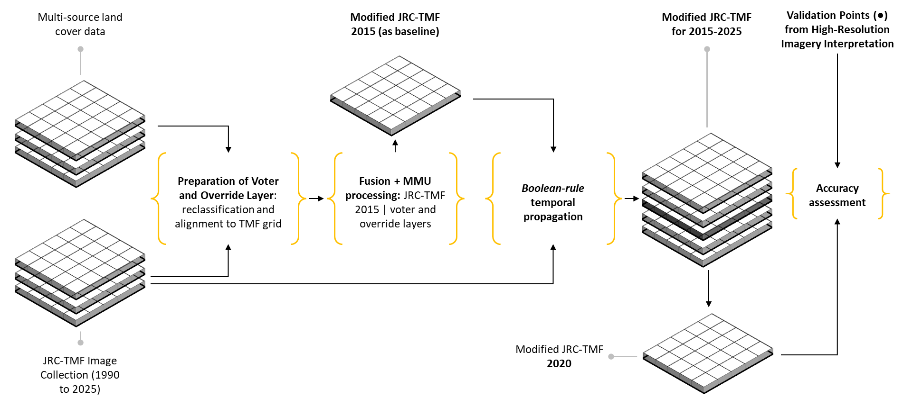

# JRC-TMF-Based Multi-Source Land-Cover Data Fusion
### Testing: Modified Historical Land-Cover Data for 2015-2025 | Case Study: Kapuas Hulu District, West Kalimantan


**Author:** Ivannalis Saputra
**Version:** 1.0-2026 (10-10-2026)

---

## Overview

Land-cover data used in REDD+ greenhouse gas accounting must meet minimum requirements for spatial resolution, accuracy, and currency (e.g., Plan Vivo: ≥ 30 m resolution and ≥ 80% accuracy). The [JRC Tropical Moist Forests (JRC-TMF)](https://forobs.jrc.ec.europa.eu/TMF) dataset offers long-term, 30 m annual coverage, but as a global product it can contain omission and commission errors at the local scale.

This repository documents a **multi-source data fusion approach** that corrects JRC-TMF forest pixels using majority voting among several global and regional datasets, an absolute override for built-up areas, and a minimum mapping unit (MMU) filter. The corrected 2015 baseline is then **propagated annually to 2025** using Boolean temporal-consistency rules that **preserve the original JRC-TMF legend**.

### Key results

| Metric (2020 validation, Combined samples) | Original JRC-TMF | Modified |
|---|---|---|
| Overall Accuracy (OA) | 79.11% | **87.77%** |
| Non-Forest omission error | 41.79% | 13.64% |
| Forest commission error | 23.59% | 9.60% |
| Forest omission error | 6.45% | 11.26% |
| Non-Forest commission error | 13.82% | 15.87% |

---

## Objectives

1. Establish a modified land-cover map for the 2015 baseline year through multi-source data fusion and propagate it annually to 2025.
2. Compare the accuracy of the original and modified JRC-TMF classifications.
3. Provide a reproducible methodology for multi-source data fusion and temporal propagation to support consistent multi-year land-cover monitoring.

---

## Study Setup

| Item | Description |
|---|---|
| Forest definition | Tree-covered landscape ≥ 0.25 ha, canopy cover ≥ 30%, tree height ≥ 5 m (Forestry Ministry Regulation P.14/2004) |
| Primary dataset | JRC-TMF Annual Changes 1990-2025 (v1_2025) |
| Baseline year | 2015 |
| Propagation period | 2016-2025 |
| Area of interest | Kapuas Hulu District (BIG, 2023 boundary) with a 120 m buffer |
| Method | Majority-voting fusion + Boolean-rule temporal propagation |
| Computing environment | Google Earth Engine (GEE) |

### Output legend (unchanged from JRC-TMF)

| Class | Description |
|---|---|
| 1 | Undisturbed Tropical Moist Forest (TMF) |
| 2 | Degraded TMF |
| 3 | Deforested land |
| 4 | Forest regrowth |
| 5 | Permanent / seasonal water |
| 6 | Other land cover |

---

## Input Datasets

Only peer-reviewed datasets with OA ≥ 80% and resolution ≤ 30 m were used, with one exception: MapBiomas Indonesia (OA ≈ 75% for Kalimantan), retained because it was developed specifically for Indonesia.

| # | Dataset | Role | Reference |
|---|---|---|---|
| 1 | JRC Tropical Moist Forests (TMF) v1_2025 | Primary (corrected) | Vancutsem et al. (2021) |
| 2 | Global Land Cover and Land Use Change 2000-2020 v2 (GLCLU2020) | Multi-attribute voter | Potapov et al. (2022) |
| 3 | Hansen Global Forest Change v1.13 | Multi-attribute voter | Hansen et al. (2013) |
| 4 | Global Land Cover Estimation (GLanCE) 2001-2019 v1 | Multi-attribute voter | See report |
| 5 | MapBiomas Indonesia Collection 4.1 (2015) | Multi-attribute voter | MBI (2023) |
| 6 | Global Cropland Extent 2000-2019 (GCE) | Single-attribute voter | Potapov et al. (2021) |
| 7 | GFSAD Global Cropland Extent (GCEP30) | Single-attribute voter | Thenkabail et al. (2021) |
| 8 | Global oil palm extent and planting year 1990-2021 (GoP) | Single-attribute voter | Descals et al. (2024) |
| 9 | GHS-BUILT-C 2018 | Override layer | Pesaresi et al. (2024) |

**Voter types**
- **Multi-attribute voters:** multiclass land-cover datasets aggregated into Forest / Non-forest.
- **Single-attribute voters:** datasets describing one class only (e.g., cropland); they abstain for all other pixels.
- **Override layers:** built-up/settlement datasets that reclassify pixels regardless of the vote.

> **Temporal note:** GCE is available in 4-year epochs (the 2015 layer represents 2012-2015). GHS-BUILT-C is only available for 2018; built-up areas are assumed to be relatively stable, making this discrepancy acceptable.

---

## Methodology



### 1. Pre-processing and legend harmonization

All datasets are reprojected and resampled to the native grid, CRS, and 30 m resolution of JRC-TMF to avoid sub-pixel misalignment. Each dataset is reclassified into a common three-class encoding:

| Code | Meaning |
|---|---|
| 1 | **Forest** - source explicitly identifies the pixel as forest |
| 2 | **Non-forest** - source explicitly identifies non-forest (cropland, built-up, bare land, water, etc.) |
| 0 | **Abstain** - no information, class outside dataset scope, or no-data |

Additional adjustments:
- **Hansen GFC:** forest defined as year-2000 tree cover ≥ 30%; pixels with forest loss during 2001-2015 are masked and reclassified as non-forest.
- **GoP:** planting years converted to nominal years; stacked layers from 1980-2015 give cumulative oil palm extent up to 2015.

### 2. Multi-source fusion (2015 baseline)

Voting is applied **only** to pixels classified as Undisturbed TMF (1) or Degraded TMF (2) in 2015 (harmonized to Forest). The fusion can therefore only **retain or reduce** forest extent; it cannot add new forest. JRC-TMF itself is not a voter.

Decision rules:

1. **Minimum evidence:** at least two valid (non-abstain) votes are required; otherwise the original JRC-TMF class is retained.
2. **Majority rule:** a pixel is reclassified when Non-forest votes strictly exceed Forest votes. Ties retain the original class.
3. **Absolute override:** built-up pixels are reclassified regardless of the vote result.

Reclassified pixels become **JRC-TMF Class 6 (Other land cover)**.

### 3. Minimum Mapping Unit (MMU) filter

Forest patches smaller than about **0.27 ha** (three contiguous 30 m pixels, 8-connected adjacency) are reclassified as Class 6.

### 4. Temporal propagation (2016-2025)

Boolean rules enforce consistency with the corrected baseline while keeping the original legend (Classes 1-6):

- **Forest extent constraint:** forest (Class 1 or 2) in year *Y* that falls outside the corrected forest extent and does not intersect Forest Regrowth (Class 4) in the corrected image of *Y-1* → Class 6.
- **Deforestation constraint:** Deforested land (Class 3) in year *Y* outside the forested and deforested areas of the corrected image of *Y-1* → Class 6.
- All other pixels retain their JRC-TMF classification.

```text
FOR each year Y = 2016 to 2025:
    Corrected(Y) = Original(Y)

    IF Original(Y) ∈ {Class 1, Class 2}
       AND Corrected(Y-1) ∉ {Class 1, Class 2, Class 4}
        THEN Corrected(Y) = Class 6
    ELSE IF Original(Y) = Class 3
       AND Corrected(Y-1) ∉ {Class 1, Class 2}
       AND Corrected(Y-1) ≠ Class 3
        THEN Corrected(Y) = Class 6
    ELSE
        Corrected(Y) = Original(Y)
    END IF
END FOR
```

---

## Accuracy Assessment

- **Reference year:** 2020 (limited by imagery availability)
- **Coverage:** 14,633 km² (~47% of the district's 31,326 km²)
- **Reference imagery:** Planet NICFI mosaics (~4.77 m, Jun-Aug 2020), supplemented by Google Earth imagery
- **Interpretation:** visual, on a 30 m × 30 m grid at 1:4,000 scale; labels are Forest or Non-forest following MoEF (2020) key image interpretation criteria
- **Samples:** 3,695 points total
  - 2,493 stratified random (5 strata based on correction pathways)
  - 1,202 systematic (~4 × 3 km spacing)

**Stratified random strata:** Undisputed Forest · Already Non-forest · Corrected by Voting/MMU · Corrected by Absolute Override · Disputed but Retained as Forest.

### Results (2020)

| Map | Sample type | Class | OA (%) | PA (%) | UA (%) | N |
|---|---|---|---|---|---|---|
| Modified | Combined | Forest | 87.77 | 88.74 | 90.40 | 2,185 |
| | | Non-Forest | | 86.36 | 84.13 | 1,510 |
| | Systematic | Forest | 93.43 | 95.68 | 96.96 | 1,068 |
| | | Non-Forest | | 76.12 | 68.46 | 134 |
| | Stratified random | Forest | 85.04 | 82.18 | 84.07 | 1,117 |
| | | Non-Forest | | 87.35 | 85.80 | 1,376 |
| Original | Combined | Forest | 79.11 | 93.55 | 76.41 | 2,185 |
| | | Non-Forest | | 58.21 | 86.18 | 1,510 |
| | Systematic | Forest | 93.68 | 96.82 | 96.10 | 1,068 |
| | | Non-Forest | | 68.66 | 73.02 | 134 |
| | Stratified random | Forest | 72.08 | 90.42 | 63.16 | 1,117 |
| | | Non-Forest | | 57.19 | 88.03 | 1,376 |

Metrics: Overall Accuracy (OA), Producer's Accuracy (PA), User's Accuracy (UA), computed from the unweighted sample confusion matrix.

---

## Area Statistics

Area statistics are **pixel-based (GEE) and indicative only**.

**Modified 2025 land cover**

| Class | Area (km²) | Share |
|---|---|---|
| 1 Undisturbed TMF | 24,012 | 76.2% |
| 2 Degraded TMF | 3,045 | 9.7% |
| 3 Deforested land | 1,906 | 6.0% |
| 4 Forest regrowth | 796 | 2.5% |
| 5 Permanent/seasonal water | 785 | 2.5% |
| 6 Other land cover | 988 | 3.1% |

**Effect of the correction (mean 2015-2025 vs. original)**
- Undisturbed TMF: ~0.2% (≈ 50 km²) difference
- Degraded TMF: ~470 km² (≈ 14%) difference
- Deforested land: ~2.3% (≈ 43 km²) difference
- Other land cover: +118% (absorbs reclassified pixels)
- Forest Regrowth (4) and Water (5) are unchanged by design

---

## Limitations

- **Small voter pool, correlated errors:** most voters are Landsat-based, so errors may be correlated.
- **Unweighted majority voting, no sensitivity analysis:** not compared with Dempster-Shafer, weighted voting, or machine-learning fusion.
- **Young/regenerating forest:** shifting cultivation and agroforestry areas may be reclassified as Non-forest, increasing Forest omission error.
- **Sampling-design dependence:** large gain in stratified samples (concentrated in corrected areas), negligible in systematic samples; the systematic Non-Forest class has only 134 points. Metrics are **not area-weighted** and do not represent a district-wide accuracy gain.
- **Limited validation:** only 2020 and ~47% of the district; 2015 and other years are not independently validated.
- **Baseline errors propagate:** forest omitted in 2015 cannot reappear later unless supported by Forest Regrowth.
- **Forest definition:** the ≥ 30% Hansen tree-cover threshold may overestimate forest extent in some landscapes.
- **Pixel-based area statistics** are less precise than vector-based or area-adjusted estimates.

**Future work:** weighted/evidence-based fusion, Sentinel-based and agroforestry datasets for later periods, and extended validation to other years and the full district.

---

## Repository Structure
```text
├── README.md
├── annex/
│   ├── 01_legend_harmonization/           # Annex 01
│   ├── 02_processing_scripts/             # Annex 02 - GEE scripts
│   └── 03_key_image_interpretation/       # Annex 03
└── LICENSE
```
---

## Citation

If you use this work, please cite:

> Saputra, I. (2026). *JRC-TMF-Based Multi-Source Land-Cover Data Fusion: Modified Historical Land-Cover Data for 2015-2025 in Kapuas Hulu District* (Version 1.0-2026). Technical Report. Bentang Kalimantan Tangguh (BKT), Program Hutan Desa (PHD).

## Key References

- Vancutsem, C. et al. (2021). Long-term (1990-2019) monitoring of forest cover changes in the humid tropics. *Science Advances*, 7(10). https://doi.org/10.1126/sciadv.abe1603
- Hansen, M. C. et al. (2013). High-resolution global maps of 21st-century forest cover change. *Science*, 342(6160), 850-853. https://doi.org/10.1126/science.1244693
- Potapov, P. et al. (2022). The Global 2000-2020 Land Cover and Land Use Change Dataset Derived From the Landsat Archive. *Frontiers in Remote Sensing*, 3. https://doi.org/10.3389/frsen.2022.856903
- Li, B. et al. (2023). An improved global land cover mapping in 2015 with 30 m resolution (GLC-2015) based on a multisource product-fusion approach. *Earth System Science Data*, 15(6), 2347-2373. https://doi.org/10.5194/essd-15-2347-2023
- Bourgoin, C. et al. (2026). GFC2020: a global map of forest land use for year 2020 to support the EU Deforestation Regulation. *Earth System Science Data*, 18(2), 1331-1365. https://doi.org/10.5194/essd-18-1331-2026
- Clinton, N., Yu, L., & Gong, P. (2015). Geographic stacking: Decision fusion to increase global land cover map accuracy. *ISPRS Journal of Photogrammetry and Remote Sensing*, 103, 57-65. https://doi.org/10.1016/j.isprsjprs.2015.02.010

The complete reference list is in the technical report.

## License

<!-- TODO: choose a license (e.g., CC BY 4.0 for data/report, MIT or Apache-2.0 for code) -->
To be specified.

## Contact

Bentang Kalimantan Tangguh (BKT) - Program Hutan Desa (PHD), Kapuas Hulu District, West Kalimantan, Indonesia.
